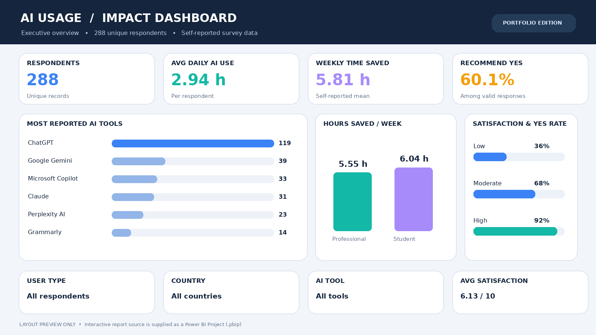
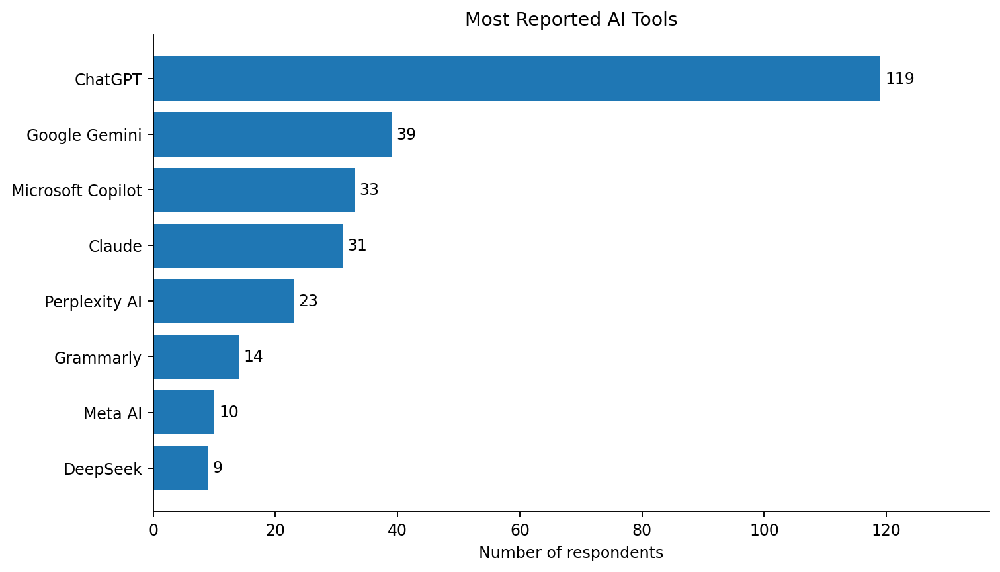
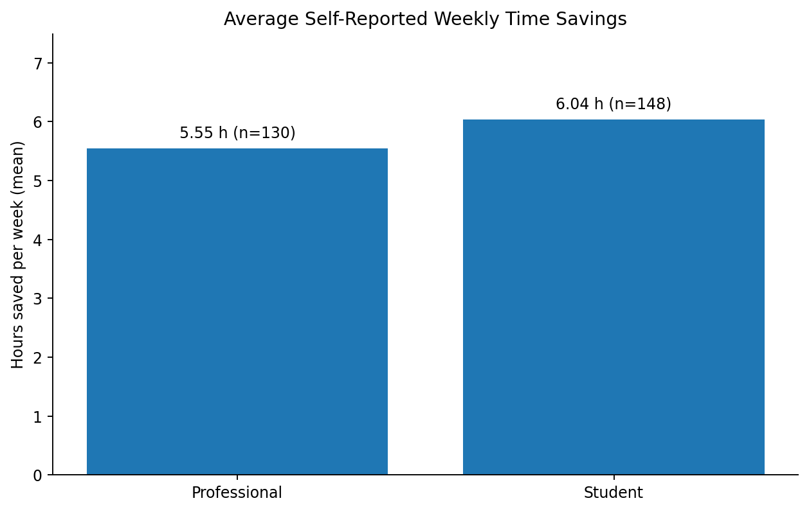
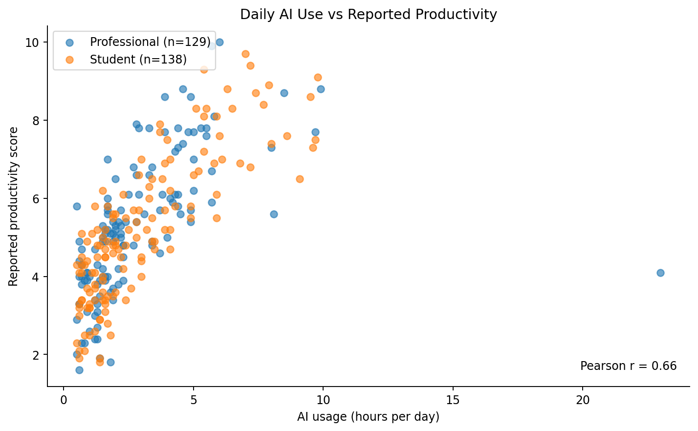

# AI Usage and Productivity — Data Analytics Portfolio Project

**Data Analytics + Power BI | Python · Pandas · Matplotlib · Jupyter · DAX · Power BI**

An end-to-end analysis of how **students and professionals** report using AI tools. The project covers raw-data auditing, data cleaning, descriptive statistics, visualization, interpretation, and reproducible exports.

> **Scope:** This is an analysis of a supplied dataset, not proof of AI's causal impact. The underlying survey's source, sampling method, and score definitions have not been independently verified.

## Project overview

| Metric | Result |
|---|---:|
| Original records | 300 |
| Original columns | 19 |
| Exact duplicate rows removed | 12 |
| Records after cleaning | 288 |
| Standardized AI tool categories | 8 |
| Reproducible charts | 6 |

### Questions addressed

1. Which AI tools are reported most often?
2. Do students and professionals report different use patterns and time savings?
3. How are daily AI usage hours associated with reported productivity?
4. Which AI tools have higher reported weekly time savings?
5. Does reported AI spending coincide with greater satisfaction?
6. Is willingness to recommend associated with satisfaction?

## Key findings

| Finding | Evidence in this sample |
|---|---|
| **ChatGPT is the most reported tool.** | 119 of 278 respondents with a known tool name (42.8%). |
| **Students report slightly more time savings.** | Average **6.04 hours/week** (148 valid reports) vs **5.55** for professionals (130 valid reports). |
| **Daily AI usage and productivity scores are positively correlated.** | **Pearson r = 0.660** across 267 valid pairs; **r = 0.781** after excluding one report above 16 AI hours/day (266 pairs). Neither is a causal estimate. |
| **Microsoft Copilot has the highest mean reported time savings among tools with at least five valid responses.** | **6.58 hours/week** across 32 valid reports; group sizes and use cases differ by tool. |
| **AI spending is not associated with higher average satisfaction here.** | Mean satisfaction **6.24** for zero reported cost (n=142) vs **5.98** for positive reported cost (n=127). |
| **Willingness to recommend rises with satisfaction.** | The share answering **Yes** is **36.1%** at satisfaction ≤5 (n=97), **67.7%** at 6–7 (n=130), and **91.8%** at ≥8 (n=49). |

These are descriptive statistics. Missing answers mean the valid sample size varies across questions.


## Interactive Power BI dashboard

This project now includes a **two-page Power BI dashboard project** (`.pbip`) with KPI cards, interactive filters, visual comparisons and DAX measures. The Power BI semantic model contains a portable snapshot of the cleaned dataset (no fixed local file paths).



**Pages:** Executive Overview (AI tool popularity, weekly time saved by user type, recommendation rate by satisfaction, slicers) and Usage & Productivity (usage/productivity scatterplot, time saved by tool, spending/satisfaction comparison).

**Open with:** `powerbi/AI_Usage_Dashboard.pbip` in a recent Power BI Desktop build, refresh the model if asked, then save as `.pbix` if preferred. The Power BI source files have been structurally checked here but **not opened in Power BI Desktop**; follow the [Power BI setup guide](powerbi/POWER_BI_GUIDE.md) for compatible versions and a manual CSV fallback.

**Source files:** [Power BI project](powerbi/AI_Usage_Dashboard.pbip) · [Setup guide](powerbi/POWER_BI_GUIDE.md) · [DAX measures](powerbi/DAX_MEASURES.md)

## Visualizations

### 1. Most reported AI tools



### 2. Students versus professionals



### 3. Daily AI usage versus productivity



**Additional charts:** [Time saved by tool](reports/figures/04_time_saved_by_tool.png) · [Satisfaction by spending](reports/figures/05_satisfaction_by_spending.png) · [Recommendation by satisfaction](reports/figures/06_recommendation_by_satisfaction.png)

## Repository structure

```text
AI-Usage-Analytics/
├── README.md
├── .gitignore
├── requirements.txt
├── data/
│   ├── raw/
│   │   └── AI_Usage_and_Impact_on_Students_and_Professionals.csv
│   └── processed/
│       └── AI_Usage_Cleaned.csv
├── notebooks/
│   └── AI_Usage_Analysis.ipynb
├── src/
│   ├── __init__.py
│   └── analysis.py
├── reports/
│   ├── data_quality_report.csv
│   ├── DATA_QUALITY_NOTES.md
│   └── figures/
│       ├── 01_ai_tool_popularity.png
│       ├── 02_time_saved_by_user_type.png
│       ├── 03_usage_vs_productivity.png
│       ├── 04_time_saved_by_tool.png
│       ├── 05_satisfaction_by_spending.png
│       └── 06_recommendation_by_satisfaction.png
├── powerbi/
│   ├── AI_Usage_Dashboard.pbip
│   ├── AI_Usage_Dashboard.Report/
│   ├── AI_Usage_Dashboard.SemanticModel/
│   ├── POWER_BI_GUIDE.md
│   ├── DAX_MEASURES.md
│   └── preview/dashboard_concept.png
└── tests/
    └── test_analysis.py
```

## How to run

**Requirements:** Python 3.10+; VS Code with the Python and Jupyter extensions is recommended.

### Windows (PowerShell)

Open a terminal **inside the repository folder**:

```powershell
py -m venv .venv
.\.venv\Scripts\python.exe -m pip install -r requirements.txt
.\.venv\Scripts\python.exe -m src.analysis
.\.venv\Scripts\python.exe -m unittest discover -s tests -v
.\.venv\Scripts\python.exe -m notebook
```

This approach does not require PowerShell script activation. Open `notebooks/AI_Usage_Analysis.ipynb` and run the cells from top to bottom. In VS Code, select the Python interpreter inside `.venv` as your notebook kernel.

### macOS / Linux

```bash
python3 -m venv .venv
source .venv/bin/activate
pip install -r requirements.txt
python -m src.analysis
python -m unittest discover -s tests -v
jupyter notebook
```

`python -m src.analysis` **recreates** the cleaned dataset, `reports/data_quality_report.csv`, and all six figure files from the raw CSV. The raw CSV is never overwritten. The notebook displays the same analysis with explanations and saved output.

## Data preparation and quality checks

- **Exact duplicates:** Removed 12 identical rows. The raw file remains unchanged.
- **Category inconsistencies:** Harmonized tool aliases such as `Chat GPT`, `chatgpt`, and `Chatgpt` → `ChatGPT`; standardized known country, education, and gender variants.
- **Numeric-as-text entries:** Converted values such as `2 hrs`, `28 yrs`, and `$20` into numeric fields.
- **Missing values:** Retained as missing, never silently changed into zero. Pandas ignores missing measurements in relevant aggregations.
- **Outliers:** Flagged suspicious observations (e.g., ages of 97, a reported monthly income of 250,000, and 23 AI usage hours/day) **without automatically deleting them**. The sensitivity check is reported for the correlation.

See [Data quality notes](reports/DATA_QUALITY_NOTES.md) and the [column-level quality report](reports/data_quality_report.csv).

## What the columns represent

| Column | Role in analysis |
|---|---|
| `User_ID` | Identifier; useful for auditing and duplicate checks |
| `User_Type` | Student or professional comparison |
| `AI_Tool` / `AI_Purpose` | AI tool and reason for using it |
| `AI_Usage_Hours_Per_Day` | Reported daily AI use |
| `Productivity_Score` | Self-reported productivity score (survey scale not documented) |
| `Time_Saved_Hours_Per_Week` | Self-reported weekly time savings |
| `Monthly_AI_Cost` | Reported spend; currency is not documented |
| `Satisfaction_Score` | Reported satisfaction score |
| `Would_Recommend` | Recommendation intent: Yes, No, Maybe |

The other variables include age, gender, country, education level, profession, income, accuracy rating, work/study hours, and a free-text task description.

## Limitations and interpretation

- **Not causal:** Higher usage correlating with reported productivity cannot establish that AI increased productivity.
- **Sampling is unknown:** Findings should not be generalized to all AI users, students, or professionals.
- **Self-report bias:** Time saved, satisfaction, usage, and productivity may not be independently measured.
- **Outliers and missing values:** Affects means, correlations, and the number of valid responses; an outlier sensitivity analysis is provided.
- **Financial data is not directly comparable:** The dataset covers several countries, but cost/income currency units are not defined.
- **Different tools may serve different users:** Tool-level time-savings comparisons are unadjusted and should not be read as objective product-performance rankings.

## Testing

Six standard-library `unittest` tests cover duplicate removal, tool-name standardization, numerical parsing, retention of missing values/outliers, and valid recommendation rates.

```bash
python -m unittest discover -s tests -v
```

## Publishing to GitHub

Create a **new empty public repository** named `AI-Usage-Analytics` on GitHub (without auto-adding a README). Then run these commands from the local project directory:

```bash
git init
git add .
git commit -m "Add reproducible AI usage data analysis portfolio project"
git branch -M main
git remote add origin https://github.com/YOUR_USERNAME/AI-Usage-Analytics.git
git push -u origin main
```

Replace `YOUR_USERNAME` with your own GitHub username.

**Dataset permission reminder:** This CSV was supplied for analysis; its original publisher and license were not verified. Make sure you have permission to redistribute the raw records before making this repository public. If not, keep the raw/processed CSV files private or omit them and document how a permitted reader can obtain the data; the analysis code can still be shared.
